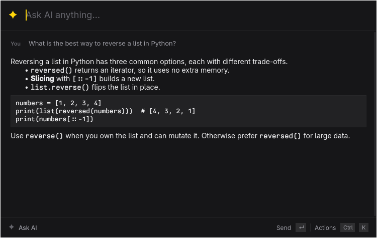

# Ask



A Raycast-style "Ask AI" popup for Omarchy. Hit a hotkey, type a question, watch the answer stream in, ask a follow-up, hit Esc. It is a Qt 6 / QML wrapper around the [`fx`](https://fx.sh) CLI (`fx ask`), so `fx` must be installed and signed in. It is not a pacman package, so the PKGBUILD cannot depend on it.

## Usage

```sh
bin/build            # build/ask
bin/test             # Qt Test, offscreen, fake fx
bin/install          # makepkg -fsi, adds Ask to the launcher
```

`ask` shows the window, or toggles it when an instance is already running. `ask --background` starts the resident process with the window hidden and does nothing if one runs already, so autostart it and bind your hotkey to plain `ask`: every press is then a message to a warm process.

Hyprland, for example:

```
exec-once = ask --background
bind = SUPER, period, exec, ask
windowrule = float on, match:class ^ask$
```

(Adapt the window rule syntax to your Hyprland version.)

Closing the window hides it. The conversation is kept until you start a new chat. Every chat gets its own working directory under `~/.local/state/ask/chats/` because `fx` scopes `--resume last` to the working directory; follow-ups pass `--resume last`.

Set `ASK_TRACE=1` to print startup and toggle timings to stderr.

## Keys

Ask takes text, so the omarchy-app defaults (Q quits, Space acts, ? help) would eat what you type. Ask deviates on purpose.

| Key | Action |
| --- | --- |
| Enter | Send |
| Shift+Enter | New line |
| Esc | Close the open panel, else stop generating, else hide the window |
| Ctrl+K | Actions panel: type to filter, arrows and Enter to run |
| Ctrl+N | New chat |
| Ctrl+Shift+C | Copy the last answer |
| Up (empty input) | Recall the last question; on the empty screen, pick an example |
| Ctrl+Q | Quit |
| F1 or Ctrl+/ | Shortcuts overlay |

## Design notes

- The Material style is dropped for QtQuick Controls Basic plus a few small components (`Palette`, `KeyCap`, `ActionsPanel`, and so on). It loads faster and the Raycast look is custom anyway. This overrides the omarchy-app skill. `theme.accent` and `theme.radius` remain the design tokens.
- QML is compiled ahead of time (`qtquickcompiler`). The actions panel and the shortcuts overlay sit behind a `Loader` and are built on first use. Nothing synchronous touches the disk or spawns a process before the first frame.
- Model output is untrusted. Markdown images become their alt text and raw `` tags are dropped, so rendering never fetches a remote resource.

## License

MIT. Theme, translation, and build scaffolding adapted from Omacut and Monologue (MIT, David Heinemeier Hansson).
