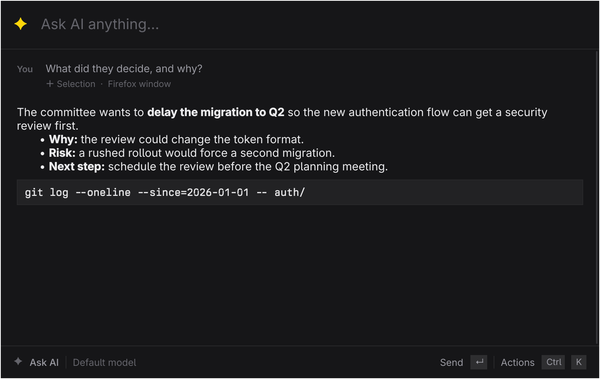
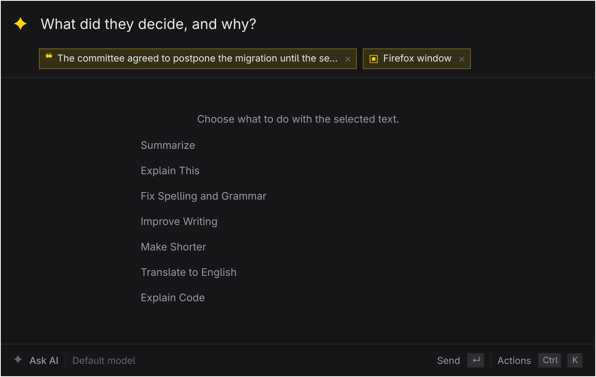
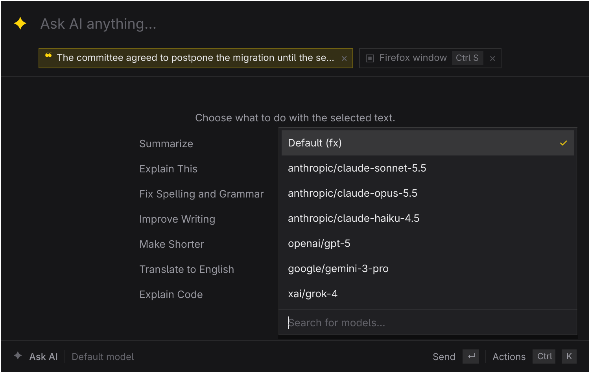

# Ask



**Ask is a fast, lightweight app for Omarchy that gives you quick AI access.** One hotkey opens a small popup on top of whatever you are doing. Type a question, or let Ask pick up the text you selected and the window you are looking at, and the answer streams in. Press the hotkey again to get rid of it. Think of it as a plugin-like companion to the Omarchy desktop, always one keypress away.

Ask runs on [`fx`](https://github.com/vercel-labs/fx), so it uses whatever account and models you already set up there. It is inspired by Raycast AI and is not affiliated with Raycast.

## Why it is fast and light

- **A resident process.** Ask starts once, hidden, and stays. Each hotkey press is a message to that warm process, not a program launch. Measured on an aarch64 laptop, the window is on screen about 25 ms after the keypress and gone about 20 ms after the next one (both include starting the tiny client that sends the message).
- **One small native binary.** C++ and Qt Quick, about 1.3 MB, linked against the Qt that Omarchy already has. No Electron, no web view, no bundled runtime. The hidden process sits at roughly 120 MB of memory.
- **Nothing runs until you need it.** The actions panel, the shortcuts overlay, and the model list are built or fetched on first use. Context is only gathered when the window is about to appear, never when it hides.

## What it does

- **Ask anything.** Follow-ups keep the conversation. `Esc` hides the window and the chat waits for you.
- **Selected text.** Highlight text anywhere, press the hotkey, and it appears as a chip under the input. It goes into the question as a quoted block.
- **Screen context.** Ask offers the window you were in as a chip. Press `Ctrl+S` and Ask captures that one window, even though Ask is now on top of it, and sends it as an image.
- **Images.** Paste an image with `Ctrl+V` or drop image files on the window.
- **AI commands.** With a selection attached, the empty state turns into Summarize, Explain This, Fix Spelling and Grammar, Improve Writing, Make Shorter, Translate to English, and Explain Code. They are also in the `Ctrl+K` actions panel.
- **Model picker.** `Ctrl+K`, then Change Model. The list comes from `fx models`, is filterable, and your choice is remembered.
- **Follows Omarchy.** Accent color and window rounding come from your theme, and the interface is translated along with Omarchy's language setting (English and Danish today).

| Selection and window chips | Model picker |
| --- | --- |
|  |  |

## Requirements

- Omarchy, with Hyprland 0.56 or newer (window capture uses Hyprland's toplevel capture)
- Qt 6.x (`qt6-base`, `qt6-declarative`, `qt6-wayland`)
- [`fx`](https://github.com/vercel-labs/fx), installed and signed in. It is not a pacman package.
- [`grim`](https://gitlab.freedesktop.org/emersion/grim) 1.5 or newer, for window screenshots
- `wl-clipboard`, for the selected text

## Install

```sh
git clone <this repository> ask
cd ask
bin/install        # builds, then makepkg -fsi, so Ask shows up in the launcher
```

`bin/build` alone produces `build/ask` without installing anything.

## Hyprland setup

Add these to your Omarchy Lua config. The first binds the hotkey, the second makes the popup a centered floating window, and the third starts the resident process when you log in.

```lua
o.bind("SUPER + PERIOD", "Ask AI", { launch = "ask" })
o.window("ask", { float = true, center = true, size = { 750, 475 } })
o.launch_on_start("ask --background")
```

`ask --background` only starts the hidden process (and does nothing if one is already running), so it is safe to autostart. If the process is not running when you press the hotkey, `ask` starts it and shows the window, just a bit slower the first time.

## Using it

Press the hotkey. The window shows, and a press of the same key hides it again, whether or not the window has focus. If you had text selected, a chip with a preview appears under the input. If a window had focus, a second chip offers a screenshot of it.

- **Chips.** Click a chip to switch it on or off, click the `×` to remove it, or press `Backspace` in an empty input to remove the last one. Switched-off chips are not sent. Hover a chip to see what it holds.
- **A selection you already used.** Primary selection lingers after you stop caring about it. If the selection is the same as the one Ask saw the last time it opened, its chip is shown switched off.
- **Screenshot.** The first time you switch the window chip on, Ask captures it in the background so sending is not delayed. If the capture fails, the chip says so, and you can click it to try again. Send waits for a capture that is still running and keeps your text.
- **What was sent.** After you send, a faint line under your question lists what it carried, such as "Selection · Firefox window".

### Keys

| Key | Action |
| --- | --- |
| Hotkey (yours) | Show, or hide if already visible |
| Enter | Send |
| Shift+Enter | New line |
| Esc | Close the open panel, else stop generating, else hide the window |
| Ctrl+K | Actions panel: type to filter, arrows and Enter to run |
| Ctrl+S | Attach or remove the window screenshot |
| Ctrl+V | Paste an image from the clipboard |
| Backspace (empty input) | Remove the last chip |
| Up (empty input) | Recall the last question, or pick an example or AI command on the empty screen |
| Ctrl+N | New chat |
| Ctrl+Shift+C | Copy the last answer |
| Ctrl+Q | Quit |
| F1 or Ctrl+/ | Shortcuts overlay |

Ask takes text, so it does not use the usual Omarchy single-key shortcuts (`Q`, Space, `?`).

### Not supported

Ask does not paste its answer back into the app you came from. That needs synthetic keyboard input, which is unreliable across terminals and browsers. Copy the answer with `Ctrl+Shift+C` instead.

## Privacy

Ask sends nothing anywhere itself. Everything you ask goes through `fx` to the provider you configured there.

- **Selected text.** Read from the primary selection with `wl-paste` at the moment you press the hotkey to show the window (1 to 2 ms, with a 150 ms limit). It is kept in memory, shown as a chip, and sent only if the chip is on when you send. It is cut to 20,000 characters. It is not written to disk by Ask.
- **Window name.** The app class and title of the focused window are read the same way, kept in memory, and used for the chip. The title is only sent if you send a screenshot, to describe it.
- **Screenshots and pasted images.** Taken only after you switch the chip on or paste. Saved in `$XDG_RUNTIME_DIR/ask/` (a memory-backed directory, mode 0700, files 0600). Deleted when the request that used them finishes, when you remove the chip, on New Chat, and when Ask quits. If Ask is killed, leftovers stay in that directory until you log out or reboot.
- **Dropped files.** Used where they are. Ask never copies, changes, or deletes your originals.
- **Hiding.** When the hotkey hides the window, nothing is read at all.
- **Chats.** Each chat has a working directory under `~/.local/state/ask/chats/`, because `fx` scopes `--resume` to the working directory. `fx` keeps its own session history as it normally does.
- **Settings.** `~/.config/ask/settings.json` holds the model you picked and nothing else.

The selected text, the window title, and the model output are untrusted. The selection is quoted in a code fence longer than any run of backticks inside it, chips and previews are drawn as plain text, and Markdown images in answers become their alt text so rendering never fetches anything.

## How it works

`ask` first tries the resident instance over a local socket, before any GUI exists. The protocol is one JSON line each way.

1. The client sends `toggle`. The resident process answers `hidden` if its window was visible (and hides it), or `need-context`.
2. Only on `need-context` does the client read the active window from Hyprland's IPC socket and the selection from `wl-paste`, and send them back. The window then shows with fresh chips. The server parses and bounds that input and ignores anything malformed.
3. A screenshot is `grim -T <window id>`, which asks the compositor for that window's own buffer, so Ask does not appear in it.
4. A question becomes `fx ask --no-color --system ... [--model ...] [--resume last] [--image ...] -- <prompt>`. The prompt assembly is a pure function with tests.

Set `ASK_TRACE=1` to print timings to stderr. `ASK_INSTANCE=<name>` runs a separate instance, which is useful for development next to an installed one.

## Development

```sh
bin/build          # build/ask
bin/test           # Qt Test, offscreen, with fake fx, grim, wl-paste and hyprctl
bin/screenshots    # rebuilds docs/*.png from the real QML, offscreen, with made-up content
```

The code is a flat `src/`. `Backend` runs `fx` and owns the chat. `Context` and `Instance` are the hotkey client and its socket. `AttachmentsModel` holds the chips, `prompt.cpp` turns question and chips into a prompt, `commands.cpp` is the AI command table, and `settings.cpp` persists the model. QML only does layout and keys.

Design notes. The Material style is replaced by Qt Quick Controls Basic and a few small components, because it loads faster and the Raycast look is custom anyway. This departs from the `omarchy-app` guidance on purpose. `theme.accent` and `theme.radius` remain the design tokens.

## License

MIT, see [LICENSE](LICENSE). Third-party software and trademarks are listed in [THIRD_PARTY_NOTICES.md](THIRD_PARTY_NOTICES.md).

## Acknowledgements

- [fx](https://github.com/vercel-labs/fx) by Vercel Labs does the actual asking.
- [Omarchy](https://omarchy.org/) and its apps Omacut and Monologue by David Heinemeier Hansson, whose theme, translation, and build scaffolding Ask adapts.
- [grim](https://gitlab.freedesktop.org/emersion/grim), [wl-clipboard](https://github.com/bugaevc/wl-clipboard), [Hyprland](https://github.com/hyprwm/Hyprland), and [Qt](https://www.qt.io/).
- Raycast, for showing how good a quick-ask popup can feel. Raycast is a trademark of Raycast Technologies Ltd, and Ask is not affiliated with it.
- Built with [Claude Code](https://claude.com/claude-code).
